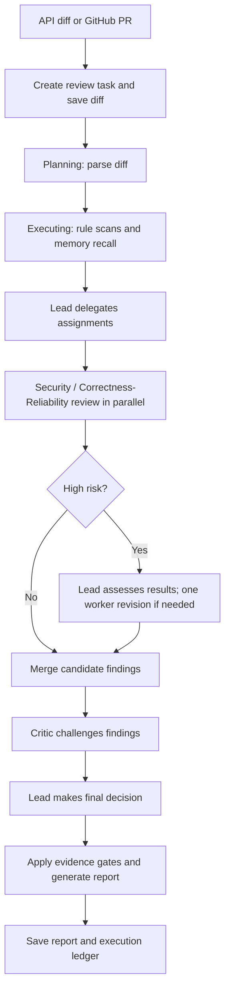

[简体中文](MODEL_RUNTIME_FLOW.md) | **English**

# EvoReview Runtime Flow

A review starts from an API request or a GitHub webhook, then goes through task orchestration, multi-agent collaboration, evidence gates, and report persistence.

A finding enters the final report only after deterministic checks for location, evidence, confidence, and the extra requirements for high-risk findings. The `ExecutionLedger` keeps the role, token usage, cost, duration, and error for every model and tool call, so the run remains auditable.

A normal review does not automatically compare versions. Use a dedicated evaluation framework outside EvoReview when you need version-level quality assessment.
