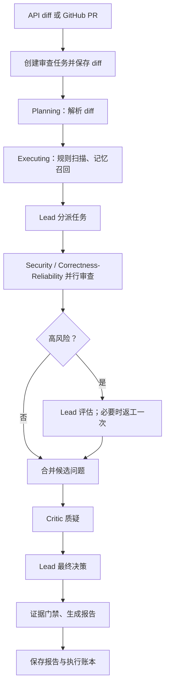

[**简体中文**](MODEL_RUNTIME_FLOW.md) | [English](MODEL_RUNTIME_FLOW.en.md)

# EvoReview 运行逻辑

一次审查从 API 请求或 GitHub Webhook 开始，经过任务编排、多角色 Agent 协作、证据门禁和报告持久化。

单条 Finding 必须通过位置、证据、置信度和高风险附加要求的确定性检查，才会进入最终报告。`ExecutionLedger` 保留每次模型调用和工具调用的角色、Token、成本、耗时与错误，供审计和问题排查使用。

普通审查完成后不会自动执行版本对比；如需版本级质量评估，请在 EvoReview 之外使用专门的评测框架。
